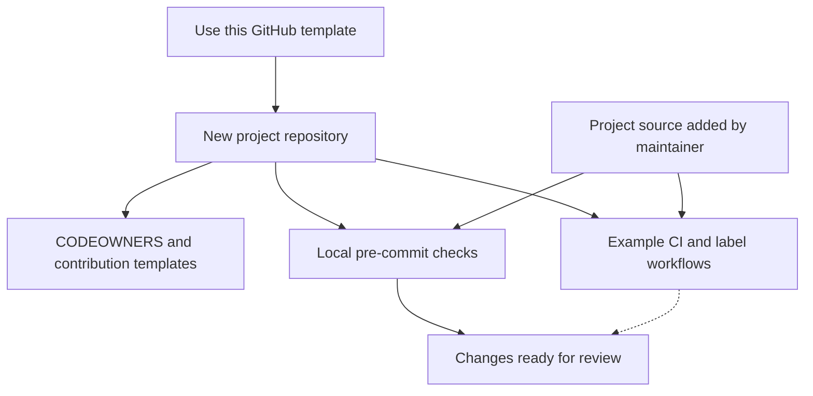

# GitHub Project Template

A starter repository for consistent project setup: ownership rules, issue and pull-request templates, a code of conduct, pre-commit checks and example GitHub Actions workflows.

**Status:** Scaffolding to adapt for each new project. The CI example expects npm scripts that are not supplied here, and the label workflow still contains placeholder values.

## Architecture

## Start here

Use GitHub's **Use this template** action, then customize [CODEOWNERS](CODEOWNERS), [.github/](.github/) and [.pre-commit-config.yaml](.pre-commit-config.yaml). Add your project's dependency manifest and test commands before enabling the CI example. The reference guide retains the optional SOPS setup notes.

[Previous README and detailed reference](https://github.com/mtzanida/github-template-repo/blob/baf4fa73cc93d78d0cd0f91b33ca62f64e2242e8/README.md) are retained in Git history. They may describe older assumptions or unmerged plans; the scope above reflects this branch.
